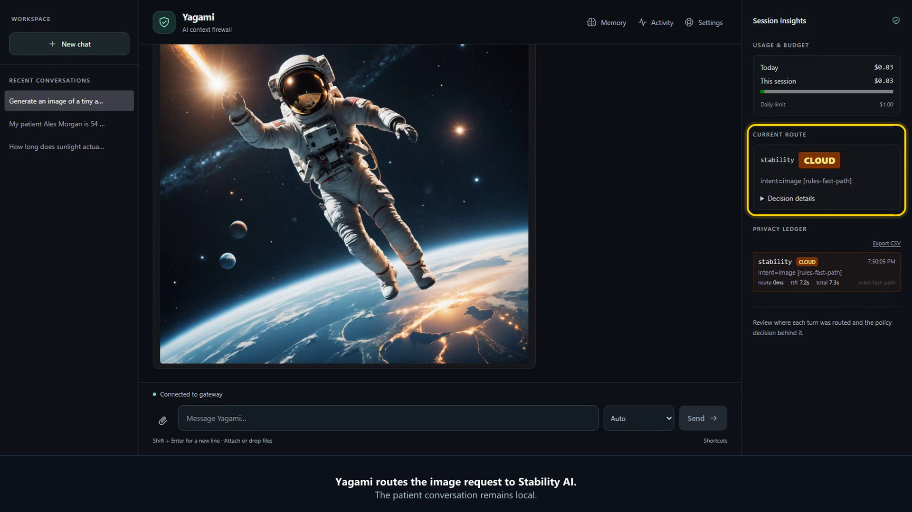

# Yagami

<!-- mcp-name: io.github.MatthewTracy/yagami -->

**An AI router that chooses models and protects privacy.**

[](https://github.com/MatthewTracy/yagami/actions/workflows/ci.yml)
[](https://pypi.org/project/yagami/)
[](https://github.com/MatthewTracy/yagami/blob/main/LICENSE)

Yagami automatically routes requests to local or cloud models based on the
task and your privacy policy. When it detects sensitive information, including
protected health information (PHI), the default policy keeps processing local.
Sensitive conversation history inherits the same restriction.

Local models can also reduce cloud API costs when they are sufficient for the
task. More demanding reasoning, research, and image generation can use cloud
models when your policy allows and the appropriate provider is configured.

Use the included browser chat or connect your application through the
OpenAI-compatible API. Yagami is open source and self-hosted; existing OpenAI
SDK applications can connect by changing one `base_url`.

## Watch Yagami in action

[](https://matthewtracy.github.io/yagami/demo/)

[Watch the 59-second demo](https://matthewtracy.github.io/yagami/demo/): an
everyday physics question, a fictional patient request kept local, and an image
generated through a cloud provider. The recording uses real models and
synthetic patient information.

The recording uses configured local and cloud providers with `yagami serve`.
The no-credential `yagami demo` command below disables cloud routing.

## Try it in 60 seconds

Choose one command:

```bash
uvx yagami demo
# or: python -m pip install yagami && yagami demo
# or: docker run --rm -p 127.0.0.1:8000:8000 ghcr.io/matthewtracy/yagami:latest yagami demo --host 0.0.0.0 --allow-remote
```

Open [http://127.0.0.1:8000](http://127.0.0.1:8000). The no-credential demo
uses the configured Ollama model when it is installed and otherwise presents a
clearly labeled policy-only fallback. It disables cloud routing while still
exercising classification, policy, lineage, storage, and audit behavior.

For local model-backed answers, install Ollama, run
`ollama pull llama3.2:3b-instruct-q4_K_M`, and restart the demo.

## Protect an application

```bash
yagami init
yagami doctor
yagami serve
```

```python
from openai import OpenAI

client = OpenAI(
    base_url="http://127.0.0.1:8000/v1",
    api_key="your-yagami-project-key",
)

response = client.chat.completions.create(
    model="yagami-auto",
    messages=[{"role": "user", "content": "Summarize this document."}],
    metadata={"sensitivity": "none", "purpose": "internal-documentation"},
)
print(response.choices[0].message.content)
```

Install `yagami[providers]` when the Yagami process or example client needs
Anthropic/OpenAI-compatible SDKs. PDF extraction uses `yagami[ingest]`, OS
keyring storage uses `yagami[desktop]`, and `yagami[all]` retains the previous
batteries-included behavior.

## What Yagami enforces

- **Sensitive-context containment.** Caller labels and local detectors can
  force PHI, clinical context, credentials, and inherited sensitive history to
  device/private-network backends.
- **Governed tools.** Function tools and MCP calls pass through policy, schema
  checks, risk controls, and optional identity-bound one-time approvals.
- **Retrieval and memory boundaries.** Namespaces, provenance, labels, TTLs,
  quarantine, and policy govern stored and retrieved context.
- **Content-free evidence.** Policy passports, audit chains, metrics, and traces
  carry labels, hashes, reason codes, counts, and timing rather than prompts,
  completions, retrieved text, or tool arguments/results.
- **Self-hosted operations.** Use SQLite locally or PostgreSQL plus distributed
  coordination for production. Containers, Compose, Helm, Prometheus,
  OpenTelemetry, backup/restore, and signed policy bundles are supported.

Yagami exposes OpenAI-compatible Chat Completions and core Responses APIs plus
Streamable HTTP MCP. It works with local Ollama, explicitly configured
llama.cpp, Foundry Local, direct cloud providers, and existing
OpenAI-compatible gateways. Frameworks can use the standard endpoint without
bypassing the same policy and evidence pipeline.

## Limits and trust

Yagami is alpha software and an enforcement component, not a compliance
certification. Detection can miss sensitive or malicious content. Strict
deployments should declare known sensitivity at the caller, fail closed, use a
local-only policy where appropriate, test organization-specific cases, and
review the threat model before production use. Telemetry is disabled by
default.

- [Documentation](https://matthewtracy.github.io/yagami/)
- [Five-minute security tour](https://matthewtracy.github.io/yagami/tour/)
- [Gateway API](https://matthewtracy.github.io/yagami/gateway/)
- [Comparison guide](https://matthewtracy.github.io/yagami/comparison/)
- [Deployment guide](https://matthewtracy.github.io/yagami/deployment/)
- [Threat model](https://matthewtracy.github.io/yagami/threat-model/)
- [Benchmark method and results](https://matthewtracy.github.io/yagami/benchmarks/)
- [Security policy](https://github.com/MatthewTracy/yagami/security/policy)
- [Roadmap](https://github.com/MatthewTracy/yagami/blob/main/docs/roadmap.md)

